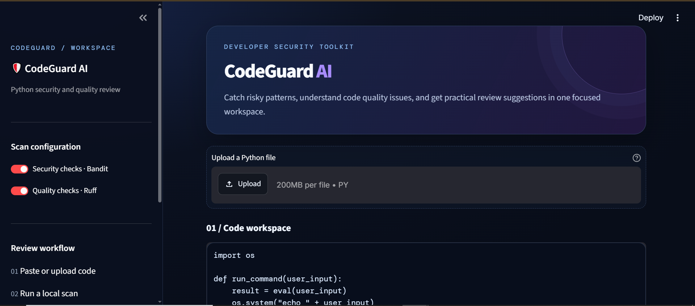
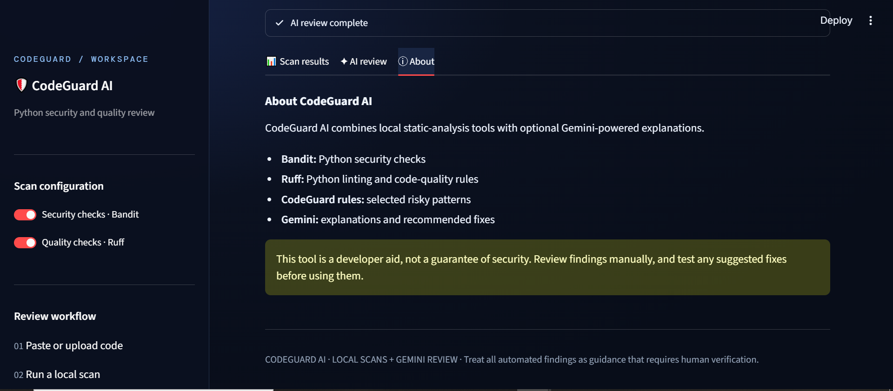

# 🛡️ CodeGuard AI


A **Python-based AI code review application** designed to help developers identify potential security vulnerabilities, code quality issues, and possible improvements in their Python programs.

CodeGuard AI combines local static analysis with AI-powered code review through Google Gemini, providing developers with a convenient way to inspect code, understand findings, and improve their programming practices.

---

# 🖥️ Application Preview


<table>
  <tr>
    <td align="center">
      
      <br>
      <b>Dashboard</b>
    </td>
    <td align="center">
      
      <br>
      <b>Code Scan Results</b>
    </td>
  </tr>
  <tr>
    <td align="center">
      
      <br>
      <b>AI Code Review</b>
    </td>
    <td align="center">
      
      <br>
      <b>About</b>
    </td>
  </tr>
</table>

---

# 📌 Overview

CodeGuard AI is a Python application that helps developers review their source code through automated analysis and AI-generated recommendations.

The application uses local analysis tools to detect selected code quality and security issues. It can also use Google Gemini to provide additional explanations, suggestions, and code improvement recommendations.

Its interface is built with Streamlit and features a cybersecurity-inspired design with dark backgrounds and neon blue and purple accents.

CodeGuard AI is intended as a development aid for students, beginners, and programmers who want to improve their understanding of secure coding practices.

---

# ✨ Features

- 🔍 **Static Code Analysis** using local analysis tools
- 🔐 **Security Checks** with Bandit
- 🧹 **Code Quality Checks** with Ruff
- 🤖 **AI-Powered Code Review** using Google Gemini
- 🚨 **Finding Severity Categories**
- 📋 **Detailed Scan Results**
- 🧠 **AI-Generated Explanations and Suggestions**
- 🎯 **Finding Filters** for easier navigation
- 📊 **Summary Cards** for scan results
- 📥 **CSV Export** for supported scan findings
- 🖥️ **Streamlit Web Interface**
- 🌌 **Dark Cybersecurity-Inspired Design**
- 🧪 **Automated Tests** for supported analyzer functionality

*Note: AI review requires a valid Gemini API key. AI suggestions and static-analysis findings should be reviewed before making changes to production code.*

---

# 🛠️ Technologies Used

## Programming Language

- Python 3.13+

## User Interface

- Streamlit

## Static Analysis and Security

- Bandit
- Ruff
- Python pattern-based checks

## Artificial Intelligence

- Google Gemini API
- Google Gen AI Python SDK

## Configuration and Environment

- `python-dotenv`
- Environment variables

## Testing

- `pytest`

## Development Tools

- Visual Studio Code
- Git
- GitHub
- Python virtual environments

---

# 🚀 Installation

## 1. Clone the Repository

Replace the repository URL with your actual GitHub repository if necessary.

```bash
git clone https://github.com/your-username/CodeGuardAI.git
```

## 2. Navigate to the Project Folder

```bash
cd CodeGuardAI
```

## 3. Create a Virtual Environment

For Python 3.13:

```bash
py -3.13 -m venv .venv
```

## 4. Activate the Virtual Environment

For Windows PowerShell:

```powershell
.\.venv\Scripts\Activate.ps1
```

If PowerShell blocks activation, allow scripts for the current terminal session:

```powershell
Set-ExecutionPolicy -Scope Process -ExecutionPolicy Bypass
.\.venv\Scripts\Activate.ps1
```

## 5. Install Dependencies

```bash
python -m pip install --upgrade pip
python -m pip install -r requirements.txt
```

## 6. Configure the Gemini API Key

Create a `.env` file in the project root directory.

```env
GEMINI_API_KEY=your_gemini_api_key_here
```

If the project uses a configurable Gemini model, you may also set:

```env
GEMINI_MODEL=your_supported_gemini_model
```

Use a model supported by your Google AI Studio account and the installed SDK.

**Important:** Never upload your actual `.env` file or API key to GitHub. Keep `.env` in `.gitignore` and use `.env.example` to document the required configuration.

## 7. Run the Application

```bash
streamlit run app.py
```

Streamlit will display a local URL in the terminal. Open that URL in your browser to use CodeGuard AI.

---

# 📖 How It Works

1. Open CodeGuard AI in your browser.
2. Provide the Python code you want to review using the available interface.
3. Run the local code analysis.
4. Review the detected findings and their severity categories.
5. Use the AI review feature for additional explanations and recommendations.
6. Filter findings to focus on specific issues.
7. Export supported scan results to CSV when needed.
8. Review the suggested improvements and verify them before applying changes.

---

# 🔎 Core Modules

- 🖥️ **Dashboard**: Main application interface and scan overview.
- 🔍 **Code Analyzer**: Runs local checks and collects findings.
- 🔐 **Security Analysis**: Uses Bandit to identify supported Python security issues.
- 🧹 **Code Quality Analysis**: Uses Ruff to report supported linting findings.
- 🤖 **AI Reviewer**: Requests additional code-review insights from Google Gemini.
- 📊 **Results Interface**: Displays findings, severity information, and filters.
- 📥 **CSV Export**: Exports supported scan findings.
- 🧪 **Tests**: Checks supported analyzer functionality.

---

# 📂 Project Structure

```text
CodeGuardAI/
│
├── app.py
├── analyzer.py
├── ai_reviewer.py
├── requirements.txt
├── .env.example
├── .gitignore
├── README.md
├── CONTRIBUTING.md
│
├── tests/
│   └── test_analyzer.py
│
└── images/
    ├── Dashboard.png
    ├── Scan Results.png
    ├── AI Review.png
    └── About.png
```

The `images/` directory is optional until screenshots are added. Keep the structure consistent with the actual files in your repository.

---

# 🔐 Security and Responsible Use

CodeGuard AI is a supporting tool, not a replacement for professional security testing or manual code review.

- Do not assume that a clean scan means code is completely secure.
- Review all findings before changing your code.
- Verify AI-generated recommendations before using them.
- Avoid submitting API keys, passwords, tokens, personal information, or confidential source code to an external AI service.
- Understand that code submitted for AI review may be sent to the configured provider for processing.
- Keep your dependencies and development tools updated.

---

# 🔮 Future Improvements

Potential improvements include:

- Support for additional programming languages
- More static-analysis integrations
- Improved finding explanations
- Before-and-after code comparisons
- Severity-based sorting and advanced filters
- Downloadable PDF reports
- Scan history and report management
- Custom security rules
- GitHub repository integration
- Continuous integration support
- Unit-test generation suggestions
- Improved AI model configuration

These are possible future additions, not necessarily features available in the current version.

---

# 👨‍💻 Developer

**Rheil Evans T. Lunio**

Computer Science Student

University of Science and Technology of Southern Philippines (USTP)

---

# 🤝 Contributing

Contributions, suggestions, bug reports, and feature improvements are welcome.

Please read [CONTRIBUTING.md](CONTRIBUTING.md) for instructions on contributing to the project.

---

# 📄 License

The project's license should be specified in the repository's `LICENSE` file. Add the appropriate license details here once the project license has been selected.
